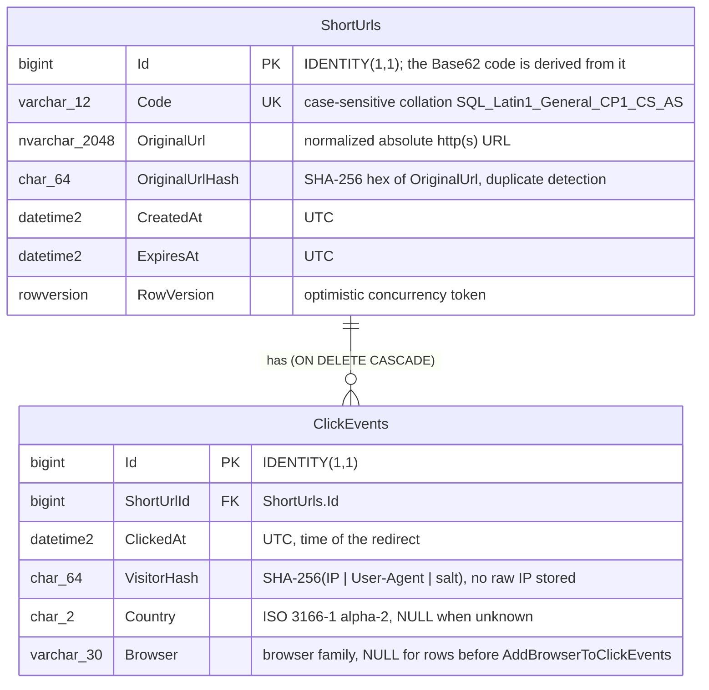

# ER Diagram & Entity Definitions

The schema as built: two tables in SQL Server, mapped by EF Core 8. The source of truth is the EF configuration in
`src/Configurations/ShortUrlConfiguration.cs` and `src/Configurations/ClickEventConfiguration.cs`; the migrations in
`src/Migrations/` create it. `docs/schema.sql` is a hand-written mirror and `docs/schema.generated.sql` is the script
EF generates (`dotnet ef migrations script --project src -o docs/schema.generated.sql`).

## Diagram

## Entities

| Entity | Class | Table | Purpose |
|--------|-------|-------|---------|
| Short URL | `src/Entities/ShortUrl.cs` | `ShortUrls` | One shortened link: code, target, lifetime. |
| Click event | `src/Entities/ClickEvent.cs` | `ClickEvents` | One successful redirect (302), written asynchronously by the click writer (spec 005). |

All `DateTime` values are UTC. EF reads them back marked UTC through `UtcDateTimeConverter` ([plan 007](plans/007-utc-expires-at.md)), so API responses serialize with `Z`.

## Indexes

| Index | Table (columns) | Unique | Used by |
|-------|-----------------|--------|---------|
| `PK_ShortUrls` | ShortUrls (Id), clustered | yes | Joins from ClickEvents; cleanup deletes by Id. |
| `UX_ShortUrls_Code` | ShortUrls (Code) | **yes** | Redirect, update, delete and analytics lookups by code (`ShortUrlRepository.GetByCodeAsync`). Also guarantees no two links share a code. |
| `IX_ShortUrls_OriginalUrlHash` | ShortUrls (OriginalUrlHash) | no | Duplicate detection on create (`FindActiveByHashAsync`). |
| `IX_ShortUrls_ExpiresAt` | ShortUrls (ExpiresAt) | no | Cleanup job: `ExpiresAt < cutoff` batches (`DeleteExpiredAsync`). |
| `PK_ClickEvents` | ClickEvents (Id), clustered | yes | Insert order; append-only workload. |
| `IX_ClickEvents_ShortUrlId_ClickedAt` | ClickEvents (ShortUrlId, ClickedAt) | no | Every analytics query: per link, optionally per date range (summary, daily, countries, browsers); also serves the FK for cascade deletes. |

## Engineer review (requirement Task 1)

**PK/FK strategy**
- **Surrogate `bigint IDENTITY` keys** on both tables. The short code is *derived* from `ShortUrls.Id` (`Base62(Id + 62^5)`, spec 001) instead of being random, so it can never collide and needs no retry loop. The trade-off is that codes are sequential and therefore guessable (documented limitation).
- **`ClickEvents.ShortUrlId` → `ShortUrls.Id` with `ON DELETE CASCADE`**: deleting a link (API or cleanup job) removes its click history in the same statement. Proven against real SQL by `DeletionTests.Delete_LinkWithClicks_RemovesItsClickEvents` and `DeletionTests.Cleanup_DeletesOnlyLinksPastGraceAndTheirClicks`.
- **`RowVersion`** gives optimistic concurrency on update: a concurrent change makes `SaveChanges` fail, and the API returns 409 instead of losing an update.

**Indexes**
- `Code` is unique **and** case-sensitive. Base62 uses both letter cases, and SQL Server's default collation is case-insensitive, so without `CS_AS` `aB1234` and `Ab1234` would collide.
- `OriginalUrl` itself is not indexed: `nvarchar(2048)` can exceed SQL Server's 1700-byte index-key limit. A fixed-width `char(64)` SHA-256 hash is indexed instead; the query then compares the full URL too, so a hash collision cannot return the wrong link.
- The hash index is deliberately **non-unique**: an expired link that cleanup hasn't deleted yet must not block shortening the same URL again.
- No index on `ClickEvents.Country` or `Browser`: those reports always filter by `ShortUrlId` first, so the composite index narrows the rows. **The index does not cover the aggregated columns** (`VisitorHash`, `Country`, `Browser`), so each report reads every matching click row of the link: the cost grows with the clicks of that link (and `ClickEvents` has no retention). Fine for ordinary links; for a very popular link, measure before relying on it.

**Query performance**
- Redirect: an index seek on `UX_ShortUrls_Code`, and most redirects never reach SQL at all (Redis cache-aside, spec 004).
- Click writes: batched (up to 100 rows per `SaveChanges`) off the request path, so redirects never wait on an insert (spec 005).
- Analytics: a range seek on `IX_ClickEvents_ShortUrlId_ClickedAt`; daily reports group by the date part of `ClickedAt` (`ClickedAt.Date` in LINQ) inside that range.
- Cleanup: batches walk `IX_ShortUrls_ExpiresAt` oldest first (`ORDER BY ExpiresAt, Id`) and delete at most `Cleanup:BatchSize` (1000) **links** per statement. The foreign-key cascade deletes all of those links' click rows in the same statement, so a statement's size is bounded by links, not by clicks; links with very many clicks make a batch large. The same applies to deleting one link through the API.

## Migrations

| Migration | Change |
|-----------|--------|
| `20261008044138_InitialCreate` | Both tables, keys, indexes, cascade. |
| `20261010022547_AddBrowserToClickEvents` | Adds nullable `ClickEvents.Browser varchar(30)` (brownfield change for browser analytics, spec 006). Existing rows keep `NULL` and are reported as `Unknown`. |
