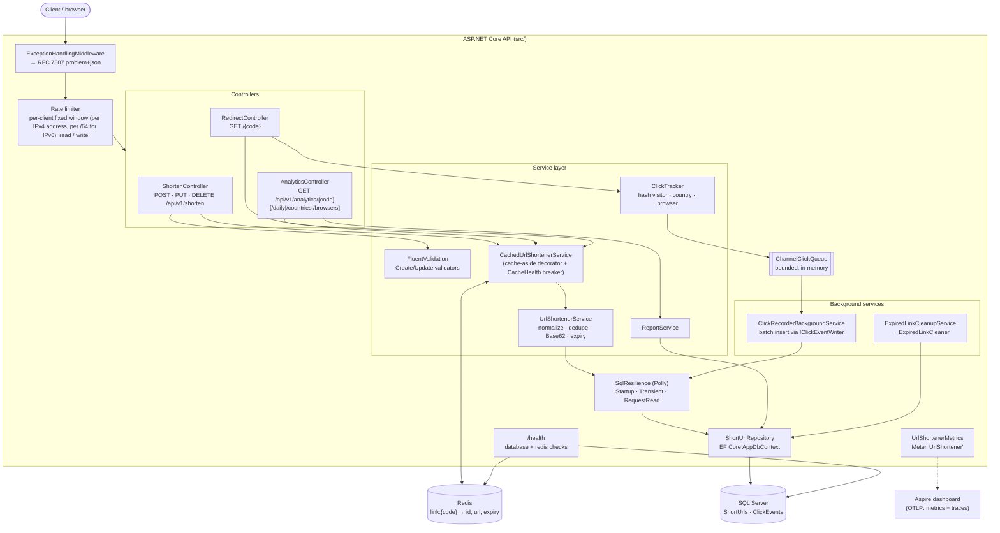
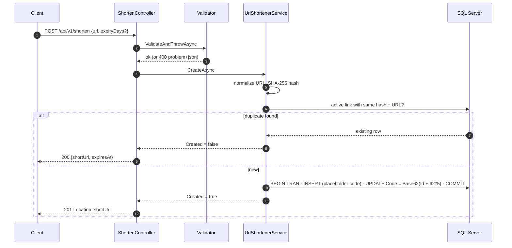
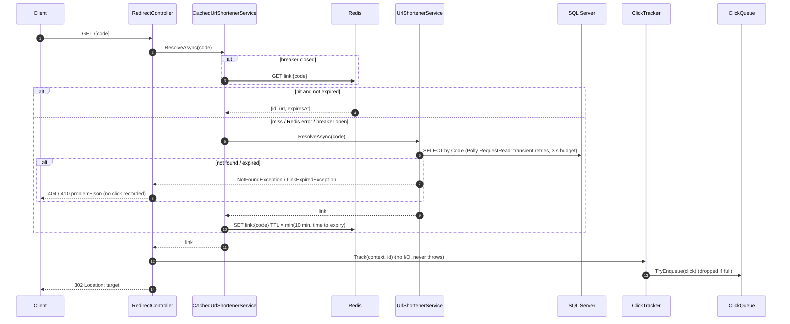
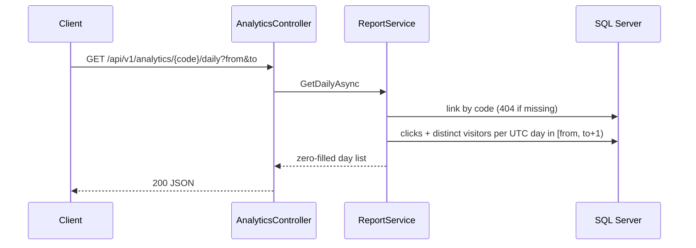
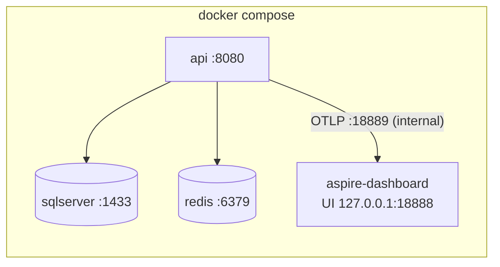

# Architecture

A single ASP.NET Core 8 Web API backed by SQL Server (EF Core 8), with Redis as a redirect cache, an in-process
queue + background worker for click analytics, a background cleanup job, and OpenTelemetry for metrics and traces.
Behaviour is specified per feature in [`docs/specs/`](specs/README.md); the schema is in [`ER-Diagram.md`](ER-Diagram.md).

## Component diagram



Key decisions behind the diagram (details in the README's *Trade-offs*):
- **Decorator for caching.** `IUrlShortenerService` resolves to `CachedUrlShortenerService`, which wraps `UrlShortenerService`. Callers can't bypass invalidation, and the core service knows nothing about Redis.
- **Reporting is separate.** `ReportService` reads the repository directly, so reporting changes never touch the redirect path.
- **Analytics are asynchronous.** The redirect only enqueues; a background worker writes in batches. Redirect latency is independent of the database's write load.

## Request flows

### Create a short URL



### Redirect (cache hit and miss)



### Click recording (background)

```mermaid
sequenceDiagram
    autonumber
    participant Q as ClickQueue
    participant W as ClickRecorderBackgroundService
    participant P as Polly Transient
    participant DB as SQL Server
    loop until shutdown
        W->>Q: wait for first click, then collect ≤ 100 clicks or 2 s
        W->>P: insert batch (fresh DbContext)
        P->>DB: INSERT ClickEvents (batch)
        alt transient error
            P->>DB: retry ≤ 3 (exponential, jitter)
            Note over W: still failing → drop batch, one error log
        else non-transient (e.g. link deleted → FK violation)
            W->>DB: insert row by row; drop only the bad click
            Note over W: a transient error here drops the rest of the batch
        end
    end
    Note over W: on shutdown the writer drains what is queued, within the host's 30 s timeout
```

### Analytics report



### Expired-link cleanup

`ExpiredLinkCleanupService` waits 30 s after start, then every `Cleanup:IntervalMinutes` (60) calls `ExpiredLinkCleaner.RunOnceAsync`. That deletes links whose `ExpiresAt` is older than `Cleanup:GracePeriodDays` (7), in batches of 1000; their clicks cascade. Until then an expired link answers **410**; afterwards **404**.

## Cross-cutting concerns

| Concern | Where | Spec |
|---------|-------|------|
| Validation | FluentValidation in `src/Validators/`, called explicitly in controllers | 001, 003 |
| Error handling | `ExceptionHandlingMiddleware` maps domain exceptions to 400/404/409/410, hides internals on 500 | 002 |
| Rate limiting | `RateLimitingSetup`: per-client fixed window (per IPv4 address, per /64 for IPv6), `write` 20/min, `read` 300/min, **on** by default | 007 |
| Resilience | `SqlResilience` (Polly): startup migration retry, transient-only retries, request-path time budget | 010 |
| Caching | Redis cache-aside with TTL ≤ link lifetime and a 30 s circuit breaker; in-memory fallback without Redis | 004 |
| Observability | `UrlShortenerMetrics` + OpenTelemetry (ASP.NET Core, HttpClient, runtime), OTLP → Aspire dashboard; Serilog console logs | 009 |
| Health | `/health`: database (Unhealthy if down) + redis (Degraded if down) | 009 |
| Time | Injected `TimeProvider` everywhere; all timestamps UTC | — |

## Deployment (docker-compose)



The API waits for SQL Server and Redis to be healthy, then applies migrations at startup (Polly retry). See the README Limitations for the fact that SQL Server and Redis ports are published on all interfaces in this development stack.
